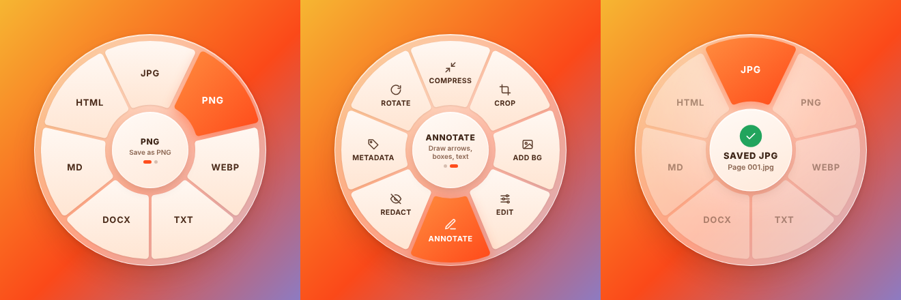
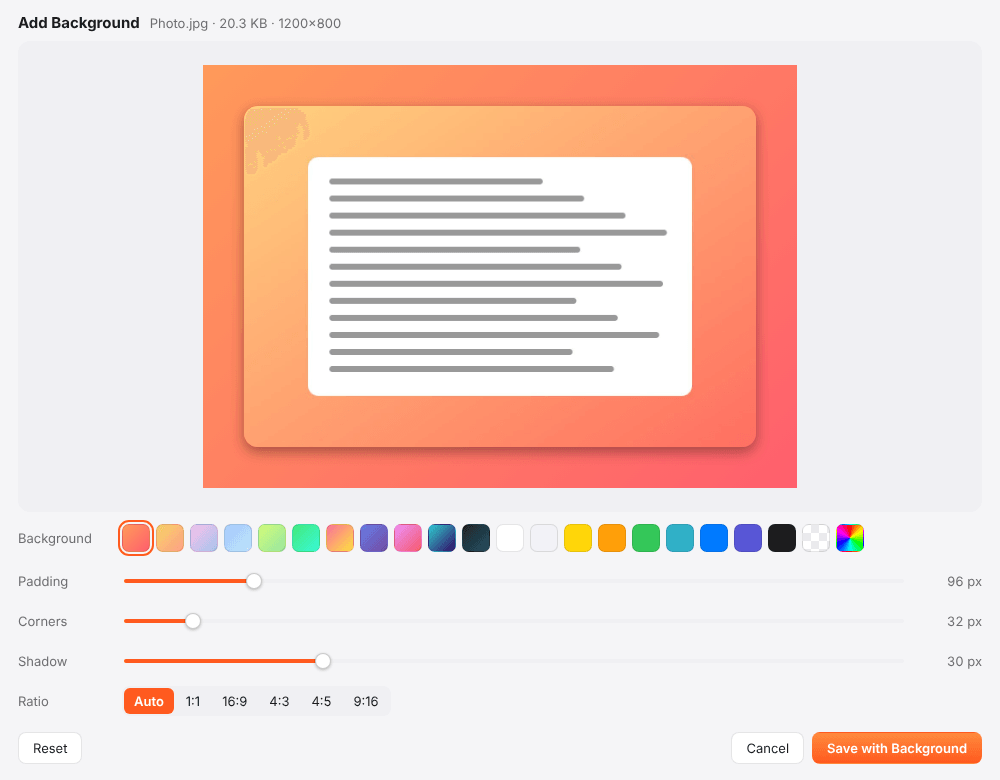
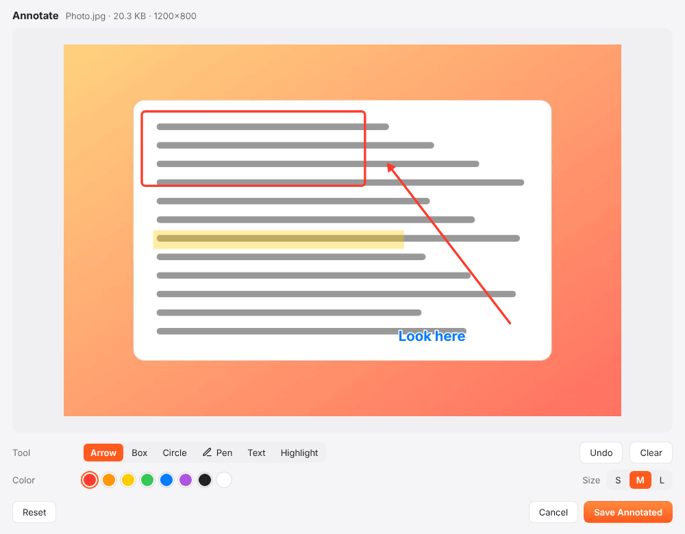

# ConvertDrag

**Convert, compress, crop, trim and merge files by holding Shift while you drag them.** A radial menu opens under your cursor; drop the file on an option and the result appears next to the original. Works on **Windows and macOS** (Linux/X11 too), and nothing is ever uploaded.



An open-source, cross-platform take on the "Shift-drag to convert" idea from Tangerine, a Mac app by Thameem. ConvertDrag is an independent project, not affiliated with it.

## How it works

1. Start dragging any file, from Finder, Explorer, your desktop, or a browser download bar.
2. Press **Shift** (you can change the key in Settings).
3. Drop the file on a wedge. Done: `Photo.heic` → `Photo.jpg`, right next to it.

- **Hover the center** for half a second (or tap Shift again) to flip between pages: *Convert* and *Tools*.
- **Drop on the center** to pin the menu open, then click options instead.
- Drag **several files** at once to convert them all, or to **merge** them (PDFs, images → PDF, videos, audio).
- Outputs never overwrite anything: a second copy becomes `Photo (2).jpg`.
- No Shift-drag? Use **Open Files…** in the tray/menu-bar icon, **Convert with ConvertDrag** in the Windows right-click menu, or **Open With → ConvertDrag** on macOS.

## What it can do

38 input formats, 264 format-to-format conversions, and 17 tools.

| Kind | Opens | Converts to | Tools |
| --- | --- | --- | --- |
| Images | JPG, PNG, WEBP, AVIF, HEIC/HEIF, TIFF, GIF, BMP, ICO, SVG | JPG, PNG, WEBP, AVIF, PDF, GIF, TIFF, BMP, ICO | Compress, Crop, Add background, Edit (brightness, contrast, saturation, rotate, flip, resize), Annotate (arrows, boxes, circles, pen, text, highlight), Redact (black box, pixelate, blur), Strip metadata, Rotate |
| Video | MP4, MOV, WEBM, MKV, AVI, WMV, FLV, MPEG, 3GP, MTS | MP4, MOV, WEBM, MKV, AVI, GIF, MP3, WAV | Compress, Trim, Mute, Scale to 720p, Save a frame, Rotate, Strip metadata, Merge |
| Audio | MP3, WAV, M4A, AAC, FLAC, OGG, OPUS, AIFF, WMA | MP3, WAV, M4A, FLAC, OGG, OPUS, AIFF, AAC | Compress, Trim, Normalize loudness, Strip metadata, Merge |
| PDF | PDF | JPG, PNG, WEBP (one image per page), TXT, DOCX, MD, HTML | Compress (recompresses embedded images, keeps text), Split into pages, Rotate, Strip metadata, Merge |
| Documents | DOCX, Markdown, TXT, HTML | PDF, DOCX, MD, TXT, HTML | Merge into one PDF |
| Data | CSV, TSV, JSON, XLSX | CSV, TSV, JSON, XLSX, Markdown table, HTML table | |

Any file or folder can also be zipped, and any mix of images, PDFs and documents can be merged into one PDF.

<p align="center">
  
  
</p>

## Install

Download the latest build from [Releases](https://github.com/beenhere/convert-drag/releases):

- **macOS** (Apple silicon: `mac-arm64`, Intel: `mac-x64`): open the `.dmg` and drag ConvertDrag to Applications.
- **Windows**: run the `win-x64` installer, or use the portable `.exe`.
- **Linux**: `AppImage` or `.deb` (X11 sessions; Wayland doesn't allow global input hooks).

Builds aren't code-signed yet, so the first launch needs one extra step:

- **macOS**: right-click the app → **Open** → **Open** (or run `xattr -dr com.apple.quarantine /Applications/ConvertDrag.app`).
- **Windows**: on the SmartScreen prompt choose **More info** → **Run anyway**.

### macOS permission

ConvertDrag has to see Shift + mouse drags that happen in other apps, which macOS only allows with **Accessibility** access. On first launch it asks for it and opens the right page: **System Settings → Privacy & Security → Accessibility → ConvertDrag**. If the menu doesn't appear, also check **Input Monitoring**. Nothing is recorded or sent anywhere; the app only watches for "left button held + moved + Shift".

## Build from source

Requires Node.js 20+.

```sh
npm install
npm start            # run the app (tray / menu-bar icon)
npm test             # converter + menu logic tests (plain Node)
npm run test:electron  # PDF rendering, printing, overlay and editor checks (needs a display; on Linux use xvfb-run)
npm run dist:mac     # or dist:win / dist:linux → installers in dist/
```

Run with `CONVERTDRAG_DEBUG=1` (or `--debug`) to log what the trigger, menu and converters are doing.

Release builds come from GitHub Actions (`.github/workflows/build.yml`): every push runs the tests, and pushing a `v*` tag builds macOS (arm64 + x64), Windows and Linux packages and attaches them to a GitHub release.

## How it's built

ConvertDrag is an Electron app. The interesting parts:

| Piece | File | What it does |
| --- | --- | --- |
| Drag trigger | `src/main/trigger.js` | A global input hook ([uiohook-napi](https://github.com/SnosMe/uiohook-napi)) fires when the left button is held, the mouse has moved, and the trigger key is down. |
| Overlay | `src/main/overlay.js`, `src/renderer/overlay/` | A transparent always-on-top window jumps under the cursor. It stays invisible until the OS reports a *file* drag entering it, so Shift-dragging text or drawing in a design app never shows anything. The menu is picked from the MIME types Chromium exposes during the drag; the file path is read on drop. |
| Catalog | `src/main/catalog.js` | File types, their menus and the conversions offered. |
| Converters | `src/main/engine/` | Plain Node: [sharp](https://sharp.pixelplumbing.com) (images), bundled [FFmpeg](https://ffmpeg.org) (audio/video, BMP/ICO), [pdf-lib](https://pdf-lib.js.org) (PDF tools), [mammoth](https://github.com/mwilliamson/mammoth.js), [docx](https://docx.js.org), [marked](https://marked.js.org), [turndown](https://github.com/mixmark-io/turndown) (documents), [ExcelJS](https://github.com/exceljs/exceljs) and [Papa Parse](https://www.papaparse.com) (data), [libheif-js](https://github.com/catdad-experiments/libheif-js) (HEIC). |
| Browser work | `src/main/bridge.js`, `src/renderer/engine/` | A hidden window runs [pdf.js](https://mozilla.github.io/pdf.js/) to render and read PDFs; HTML/Markdown/DOCX → PDF uses Chromium's print engine. |
| Editors | `src/main/editors.js`, `src/renderer/editor/` | Crop, Add background, Edit, Annotate, Redact and Trim windows. They only preview; the main process renders the saved file from the editor's parameters with the same maths (CSS filter formulas, shared SVG for annotations). |

To add a conversion: list the format in `FORMATS` and the target in `TARGETS` (`src/main/catalog.js`), handle it in the matching module in `src/main/engine/`, and add a case to `test/engine.test.js`.

## Limits worth knowing

- **HEIC** can be opened but not written (no HEVC encoder is bundled).
- **PDF → DOCX/MD/TXT** extracts text with simple heading detection; layout, tables and images are not rebuilt. Scanned PDFs have no text to extract (there's no OCR).
- **PDF Compress** shrinks embedded photos; PDFs that are mostly text or vector art won't get much smaller.
- During a drag, browsers only reveal a file's type, not its name. For types the OS doesn't map to a MIME type, the menu shows *Drop here*: drop on the center and the full menu opens with the real options.
- Windows ARM builds aren't produced (no ARM FFmpeg in the bundle); the x64 build runs under emulation.

## Privacy

Everything runs on your machine. ConvertDrag makes no network requests: no analytics, no update pings, no uploads.

## License

ConvertDrag is [MIT licensed](LICENSE). Release builds bundle third-party software under its own licenses, including FFmpeg (GPL, via [ffmpeg-static](https://github.com/eugeneware/ffmpeg-static)), libvips (LGPL, via sharp), pdf.js (Apache 2.0) and Electron/Chromium (MIT/BSD); see each package for details.
