<p align="center">
  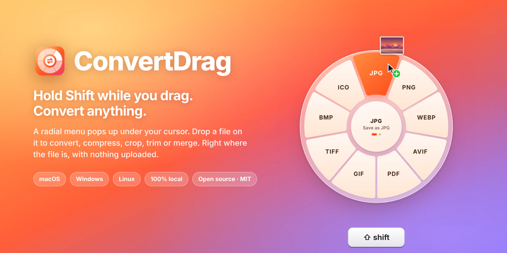
</p>

<p align="center">
  <a href="https://github.com/beenhere/convert-drag/actions/workflows/build.yml"></a>
  
  
  <a href="LICENSE"></a>
</p>

<p align="center">
  <b><a href="https://github.com/beenhere/convert-drag/releases">Download</a></b> ·
  <a href="#see-it-in-action">Demo</a> ·
  <a href="#one-menu-for-every-file">Menus</a> ·
  <a href="#editors-when-you-need-them">Editors</a> ·
  <a href="#what-it-can-do">Formats</a> ·
  <a href="#build-from-source">Build</a>
</p>

---

A HEIC from your phone that a website won't take. A 300 MB screen recording that won't attach. A PDF someone wants as a Word file. Normally that means opening an app, hunting for *Export…*, picking a format and a folder.

**With ConvertDrag you start dragging the file, press Shift, and drop it on what you want.** The new file appears right next to the original. No app to open, no upload, no waiting on a website.

## See it in action

<p align="center">
  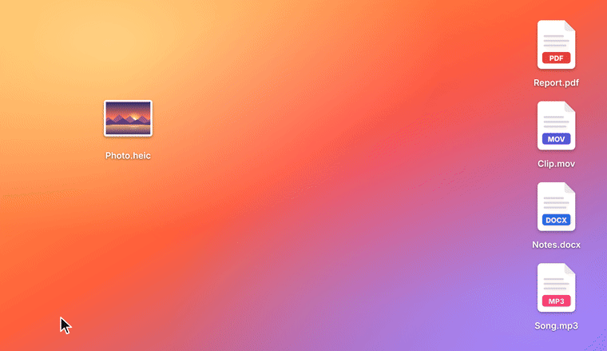
</p>
<p align="center"><sub>Drag <code>Photo.heic</code> · press <kbd>Shift</kbd> · drop on <b>JPG</b> · <code>Photo.jpg</code> appears next to it. (<a href="docs/demo.mp4">MP4 version</a>)</sub></p>

## One menu for every file

The menu knows what you're dragging and shows only what makes sense for it. Hover the center (or tap <kbd>Shift</kbd> again) to flip between **Convert** and **Tools**.

<table>
  <tr>
    <td width="33%">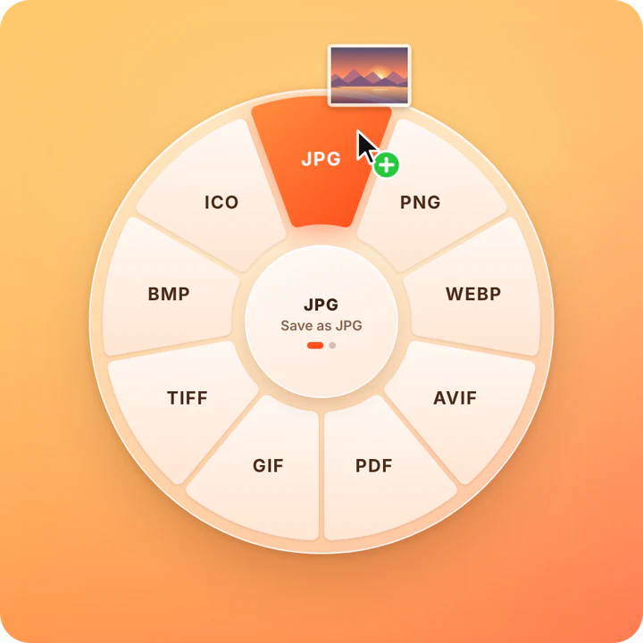</td>
    <td width="33%">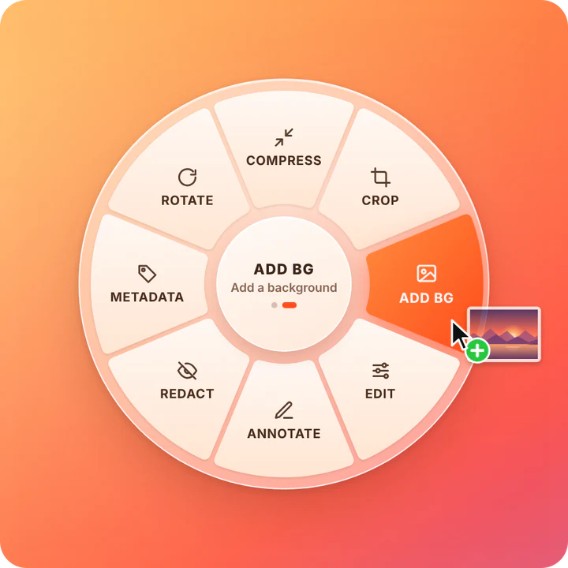</td>
    <td width="33%">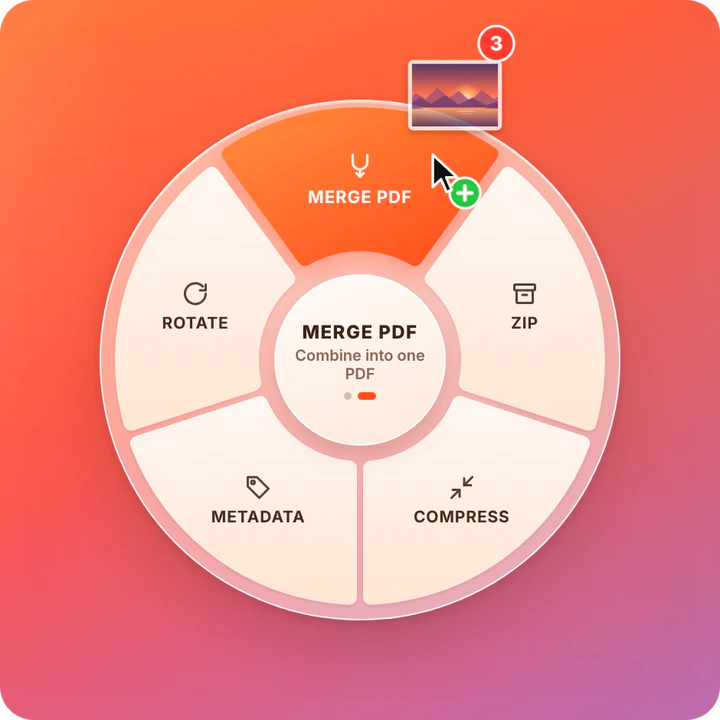</td>
  </tr>
  <tr>
    <td><b>Convert.</b> Nine formats for a photo, HEIC included.</td>
    <td><b>Tools.</b> Compress, crop, add a background, annotate, redact…</td>
    <td><b>Several files.</b> Convert them all, or merge them into one PDF.</td>
  </tr>
  <tr>
    <td>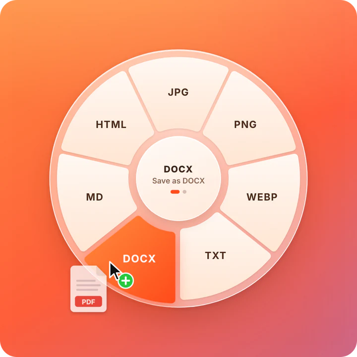</td>
    <td>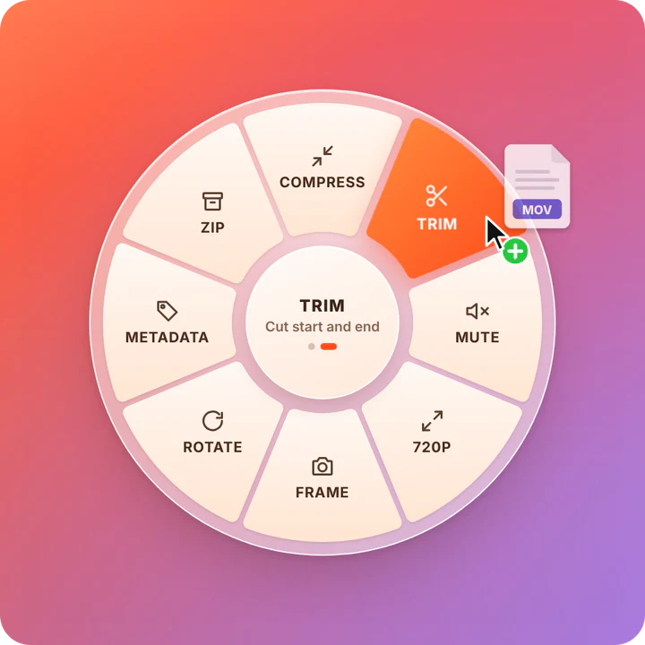</td>
    <td>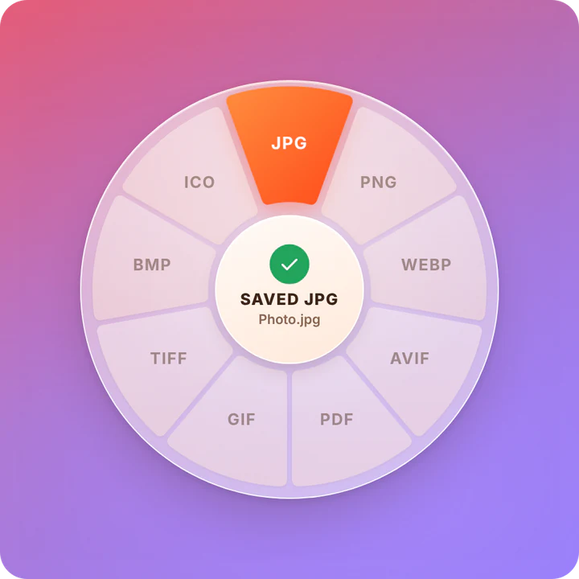</td>
  </tr>
  <tr>
    <td><b>PDFs.</b> To Word, Markdown, text or one image per page.</td>
    <td><b>Video &amp; audio.</b> Compress, trim, mute, grab a frame.</td>
    <td><b>Done.</b> Saved next to the original, never overwritten.</td>
  </tr>
</table>

## Editors when you need them

Some tools need a moment of input. Those open a small window with a live preview; everything else happens straight from the menu.

<table>
  <tr>
    <td width="50%">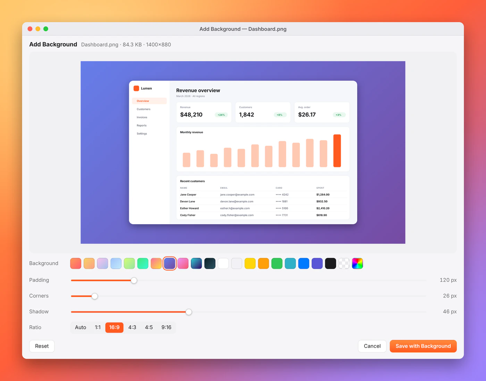</td>
    <td width="50%">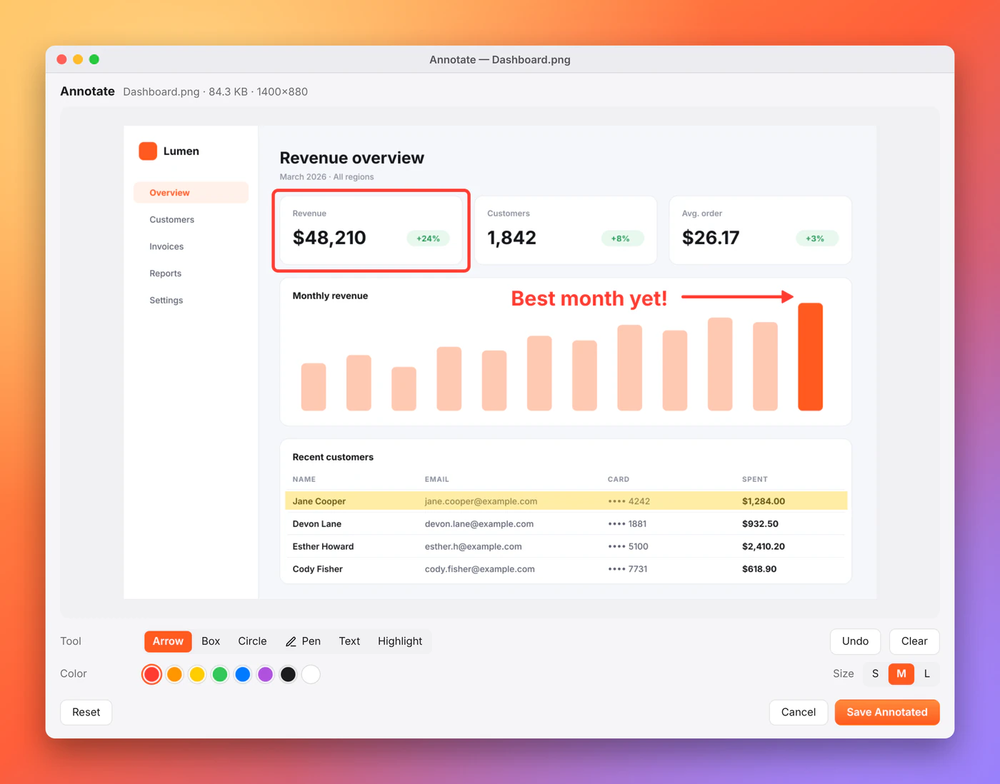</td>
  </tr>
  <tr>
    <td><b>Add background.</b> Turn a screenshot into something you'd post: gradient or solid backdrop, padding, rounded corners, shadow, 16:9 / 1:1 / 4:5.</td>
    <td><b>Annotate.</b> Arrows, boxes, circles, pen, text and highlighter.</td>
  </tr>
  <tr>
    <td>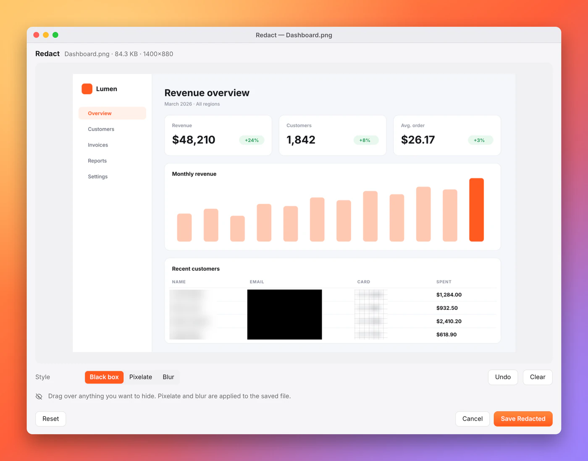</td>
    <td>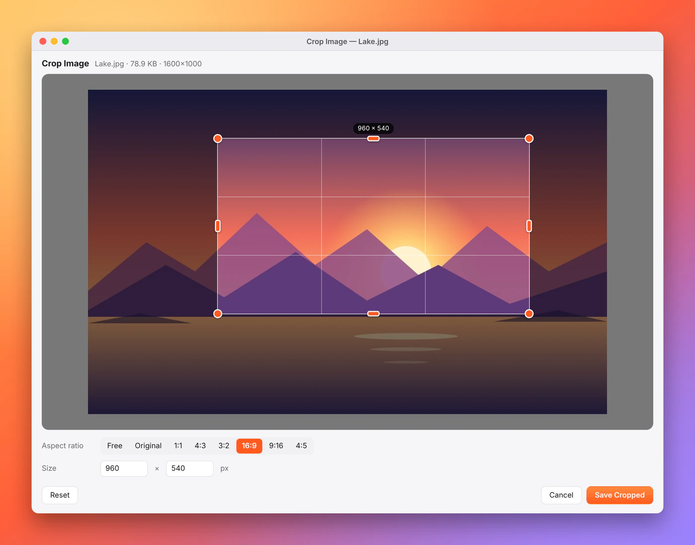</td>
  </tr>
  <tr>
    <td><b>Redact.</b> Black box, pixelate or blur anything before you share it.</td>
    <td><b>Crop.</b> Free or fixed ratios, with handles and exact pixel sizes.</td>
  </tr>
  <tr>
    <td>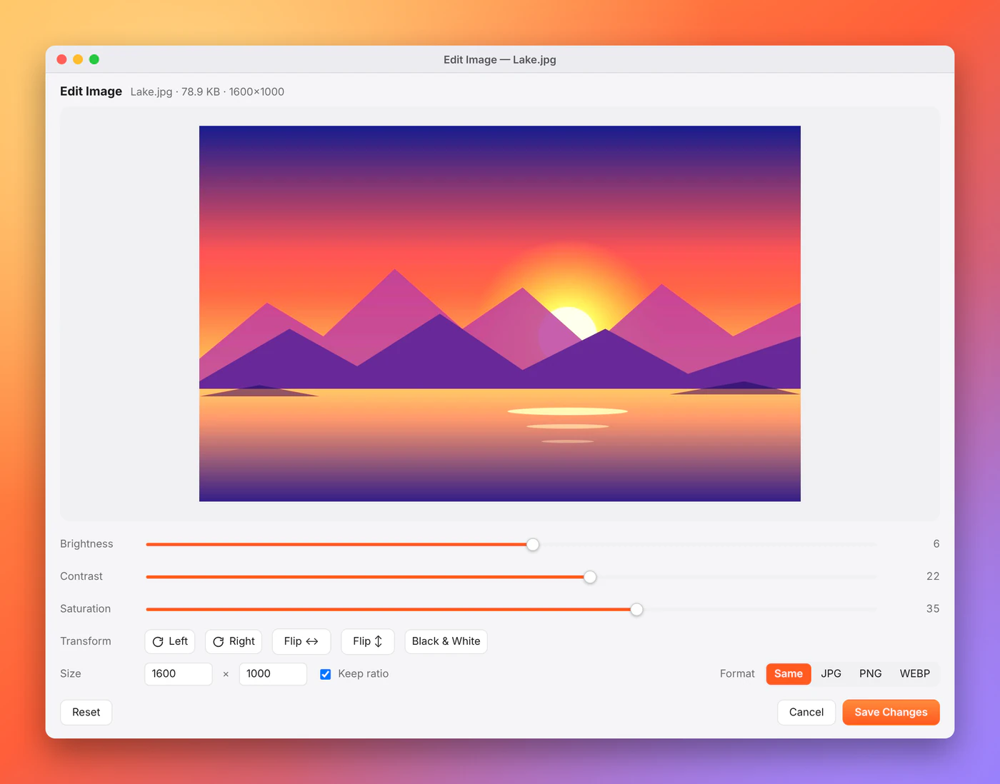</td>
    <td>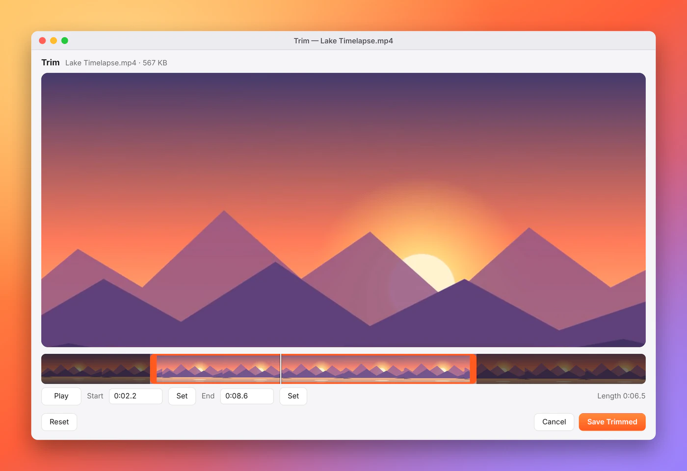</td>
  </tr>
  <tr>
    <td><b>Edit.</b> Brightness, contrast, saturation, black &amp; white, rotate, flip and resize.</td>
    <td><b>Trim.</b> Drag the handles on a filmstrip, preview the cut, save.</td>
  </tr>
</table>

## How to use it

1. Start dragging any file: from Finder, Explorer, the desktop, or a browser's download bar.
2. Press <kbd>Shift</kbd>. The menu pops up under the cursor.
3. Drop the file on a wedge.

- **Flip pages:** hover the center for half a second, or tap <kbd>Shift</kbd> again.
- **Changed your mind?** Press <kbd>Esc</kbd> to cancel the drag, as usual.
- **Prefer clicking?** Drop on the center and the menu stays open.
- **Several files at once** are converted together, or merged (PDFs, images → PDF, videos, audio).
- **Nothing gets overwritten:** a second copy becomes `Photo (2).jpg`.
- **No drag needed:** use *Open Files…* in the menu-bar/tray icon, *Convert with ConvertDrag* in the Windows right-click menu, or *Open With → ConvertDrag* on macOS.

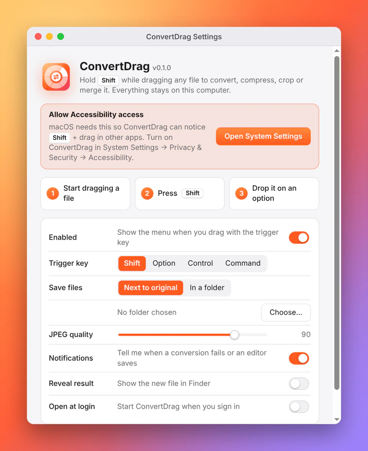

### Settings

- **Trigger key:** Shift, Option/Alt, Control or Command/Win.
- **Where files go:** next to the original, or one folder of your choice.
- **JPEG quality**, notifications, show the result in Finder/Explorer, and open at login.

ConvertDrag lives in the menu bar (macOS) or the system tray (Windows/Linux). It has no window to keep open.

<br clear="right">

## What it can do

**38 input formats, 264 format-to-format conversions, and 17 tools.**

| | Opens | Converts to | Tools |
| --- | --- | --- | --- |
| 🖼️ **Images** | JPG, PNG, WEBP, AVIF, HEIC/HEIF, TIFF, GIF, BMP, ICO, SVG | JPG, PNG, WEBP, AVIF, PDF, GIF, TIFF, BMP, ICO | Compress, Crop, Add background, Edit, Annotate, Redact, Strip metadata, Rotate |
| 🎬 **Video** | MP4, MOV, WEBM, MKV, AVI, WMV, FLV, MPEG, 3GP, MTS | MP4, MOV, WEBM, MKV, AVI, GIF, MP3, WAV | Compress, Trim, Mute, Scale to 720p, Save a frame, Rotate, Strip metadata, Merge |
| 🎧 **Audio** | MP3, WAV, M4A, AAC, FLAC, OGG, OPUS, AIFF, WMA | MP3, WAV, M4A, FLAC, OGG, OPUS, AIFF, AAC | Compress, Trim, Normalize loudness, Strip metadata, Merge |
| 📄 **PDF** | PDF | JPG, PNG, WEBP (one per page), TXT, DOCX, MD, HTML | Compress, Split into pages, Rotate, Strip metadata, Merge |
| 📝 **Documents** | DOCX, Markdown, TXT, HTML | PDF, DOCX, MD, TXT, HTML | Merge into one PDF |
| 📊 **Data** | CSV, TSV, JSON, XLSX | CSV, TSV, JSON, XLSX, Markdown table, HTML table | |

Any file or folder can be zipped, and any mix of images, PDFs and documents can be merged into one PDF.

## Install

Download the latest build from **[Releases](https://github.com/beenhere/convert-drag/releases)**. Until the first release is tagged, every [Build run](https://github.com/beenhere/convert-drag/actions/workflows/build.yml) attaches the installers as artifacts.

| | File | |
| --- | --- | --- |
| **macOS**, Apple silicon | `ConvertDrag-…-mac-arm64.dmg` | Open it and drag ConvertDrag to Applications |
| **macOS**, Intel | `ConvertDrag-…-mac-x64.dmg` | |
| **Windows** | `ConvertDrag-…-win-x64.exe` | Installer, or the `-portable.exe` |
| **Linux** | `.AppImage` or `.deb` | X11 sessions (Wayland doesn't allow global input hooks) |

The builds aren't code-signed yet, so the first launch needs one extra step:

- **macOS:** right-click the app → **Open** → **Open** (or run `xattr -dr com.apple.quarantine /Applications/ConvertDrag.app`).
- **Windows:** on the SmartScreen prompt choose **More info** → **Run anyway**.

> [!NOTE]
> **macOS asks for Accessibility access.** ConvertDrag needs to notice <kbd>Shift</kbd> + drag in other apps, which macOS only allows with that permission. On first launch it asks and opens **System Settings → Privacy & Security → Accessibility**. If the menu still doesn't appear, check **Input Monitoring** too. The app only watches for "left button held + moved + Shift"; nothing is recorded or sent anywhere.

## How it works

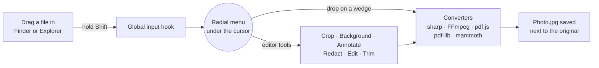

ConvertDrag is an Electron app; every conversion runs in-process or in a bundled binary on your machine.

| Piece | Where | What it does |
| --- | --- | --- |
| Drag trigger | `src/main/trigger.js` | A global input hook ([uiohook-napi](https://github.com/SnosMe/uiohook-napi)) fires when the left button is held, the mouse has moved and the trigger key is down. |
| Overlay | `src/main/overlay.js`, `src/renderer/overlay/` | A transparent, always-on-top window jumps under the cursor. It stays invisible until the OS reports a *file* drag entering it, so Shift-dragging text or drawing in a design app shows nothing. The menu comes from the file types Chromium exposes during the drag; the path is read on drop. |
| Catalog | `src/main/catalog.js` | File types, their menus, and which conversions each one gets. |
| Converters | `src/main/engine/` | [sharp](https://sharp.pixelplumbing.com) for images, bundled [FFmpeg](https://ffmpeg.org) for audio and video, [pdf-lib](https://pdf-lib.js.org) for PDF tools, [mammoth](https://github.com/mwilliamson/mammoth.js), [docx](https://docx.js.org), [marked](https://marked.js.org) and [turndown](https://github.com/mixmark-io/turndown) for documents, [ExcelJS](https://github.com/exceljs/exceljs) and [Papa Parse](https://www.papaparse.com) for data, [libheif-js](https://github.com/catdad-experiments/libheif-js) for HEIC. |
| Browser work | `src/main/bridge.js`, `src/renderer/engine/` | A hidden window runs [pdf.js](https://mozilla.github.io/pdf.js/) to render and read PDFs; documents become PDFs through Chromium's print engine. |
| Editors | `src/main/editors.js`, `src/renderer/editor/` | The editor windows only preview. The main process renders the saved file from their settings with the same maths (CSS filter formulas, one shared SVG for annotations), so what you see is what you get. |

## Build from source

Requires Node.js 20 or newer.

```sh
npm install
npm start               # run the app (menu-bar / tray icon)
npm test                # converter, menu and trigger tests (plain Node)
npm run test:electron   # PDF rendering, printing, menu and editor checks (needs a display; xvfb-run on Linux)
npm run screenshots     # regenerate the images in docs/
npm run dist:mac        # or dist:win / dist:linux → installers in dist/
```

Set `CONVERTDRAG_DEBUG=1` (or pass `--debug`) to log what the trigger, menu and converters are doing.

Every push runs the tests in GitHub Actions; pushing a `v*` tag also builds macOS (arm64 + x64), Windows and Linux packages and publishes them as a release.

**Adding a conversion:** list the format in `FORMATS` and the target in `TARGETS` in `src/main/catalog.js`, handle it in the matching module under `src/main/engine/`, and add a case to `test/engine.test.js`. Pull requests are welcome.

## Limits worth knowing

- **HEIC** can be opened but not written (no HEVC encoder is bundled).
- **PDF → DOCX/MD/TXT** extracts the text with simple heading detection; layout, tables and images aren't rebuilt. Scanned PDFs have no text to extract (there's no OCR).
- **PDF Compress** shrinks the photos inside a PDF; PDFs that are mostly text or vector art won't get much smaller.
- While dragging, the OS reveals a file's type but not its name. For types it can't name, the menu says *Drop here*: drop on the center and the full menu opens.
- There's no Windows ARM build (the bundled FFmpeg is x64-only); the x64 build runs under emulation.

## Privacy

Everything runs on your computer. ConvertDrag makes no network requests: no analytics, no update checks, no uploads.

## License & credits

ConvertDrag is [MIT licensed](LICENSE). Release builds bundle third-party software under its own licenses, including FFmpeg (GPL, via [ffmpeg-static](https://github.com/eugeneware/ffmpeg-static)), libvips (LGPL, via sharp), pdf.js (Apache 2.0) and Electron/Chromium; see each package for details.

The Shift-drag idea comes from **Tangerine**, a Mac app by Thameem. ConvertDrag is an independent, open-source, cross-platform take on it and isn't affiliated with Tangerine.
